# filename · A — 모델 품질 실험

선택 모델: **`google/gemma-4-12b-qat`**. Colab에서 해상도·시각 토큰·출력 토큰·프레임 수·전처리 조건을 비교합니다.

평가 데이터는 팀이 ZIP으로 업로드합니다. `videos/`에 원본 영상을 넣으면 FFmpeg로 대표 프레임을 추출합니다. 기본은 10초당 1장·최대 5장입니다. [추출 설정](docs/VIDEO_FRAMES.md)을 참고하세요. 평가 사진과 정답은 합성하지 않습니다.

## 동작 구조

**같은 자료를 입력 조건만 바꿔 분석하고, 품질을 유지할 수 있는 설정을 찾습니다.** 아래는 실제 모델을 사용하는 실행 흐름입니다.



[크게 보기 · PNG](docs/diagrams/flow.png) · [수정 가능한 Mermaid 원본](docs/diagrams/flow.mmd)


- **한 번에 한 조건을 비교합니다.** 예를 들어 해상도 실험은 토큰·프레임 수를 고정하고 1080 → 720 → 480px 등으로 바꿉니다.
- **모델은 처음 불러온 뒤 재사용합니다.** 사진 한 장 또는 영상 프레임 묶음 하나를 요청 한 건으로 보냅니다. 여러 프레임은 같은 영상의 시간순 장면입니다.
- **내용과 형식을 따로 평가합니다.** JSON 형식은 자동 검사하고, 정답이 있으면 태그 문자열 일치를 진단합니다. 의미 정확도는 사람이 평가합니다. 정답 파일은 모델에 전달하지 않습니다.

`--dry-run`은 입력·계획 확인까지, `--mock`은 실제 모델 대신 고정 응답으로 실행합니다. 메모리 부족·시간 초과 같은 실행 오류로 중단되면 확보한 기록으로 리포트를 만듭니다. A에서 고른 설정은 B의 실제 Q4 모델에서도 품질을 다시 확인합니다.

코드에서 따라갈 순서: [업로드](filename_bench/uploads.py) → [입력·프레임 처리](filename_bench/data.py) → [실험 반복](filename_bench/runner.py) → [모델 호출](filename_bench/backends.py) → [리포트](filename_bench/report.py).

## Colab에서 시작하기

[Colab 노트북 열기](https://colab.research.google.com/github/yooongZa/filename-model-quality-bench/blob/main/notebooks/A_colab_quality.ipynb)

1. 설치 셀을 실행합니다.
2. Google Drive의 `내 드라이브/filename/datasets/evaluation.zip`에 평가 ZIP을 올리고, 노트북에서 Drive를 연결합니다.
3. **바꿔 볼 설정** 셀에서 해상도·토큰·프레임 수를 정합니다.
4. `MOCK=True`로 흐름을 확인한 뒤 `False`로 실제 평가합니다.
5. 결과는 `내 드라이브/filename/runs/<실험이름>/`에 저장됩니다. 마지막 셀에서 공유용 ZIP도 저장합니다.

Drive 경로는 노트북의 `DRIVE_ROOT`·`DRIVE_ZIP`에서 바꿉니다. 원문은 요청마다 저장하며, 같은 조건을 이어서 실행하려면 `RESUME_RUN_NAME`에 기존 실험 이름을 넣습니다. `USE_DRIVE=False`로 기존 PC 업로드도 사용할 수 있습니다. [Drive 데이터·결과 저장 안내](docs/COLAB_DRIVE.md)

A의 실제 실행은 A100 등 CUDA GPU와 모델 접근 권한이 필요합니다. Google의 QAT 학습 체크포인트를 **BF16**으로 실행합니다. 로컬 Q4의 품질은 B에서 재확인합니다. [모델 구분](docs/MODEL.md)

## 터미널에서 시작하기

Python 3.10 이상을 사용합니다.

```bash
git clone https://github.com/yooongZa/filename-model-quality-bench.git
cd filename-model-quality-bench
python -m venv .venv
# macOS/Linux: source .venv/bin/activate
# Windows PowerShell: .venv\Scripts\Activate.ps1
python -m pip install -r requirements.txt
python upload_dataset.py evaluation.zip --destination data/evaluation
```

마지막 명령이 출력한 실제 데이터 경로를 아래 `--dataset-root`에 넣습니다. 폴더 구조는 [데이터 업로드 안내](docs/DATASET.md)를 참고하세요.

```bash
python a_quality.py --dataset-root data/evaluation --dry-run
python a_quality.py --dataset-root data/evaluation --mock --run-dir runs/first_check
```

모의 실행은 고정 응답으로 저장·검사·리포트를 확인합니다. 실제 추론 전 `python -m pip install -r requirements-colab.txt`로 모델 실행 패키지를 준비하세요. `--mock`을 빼면 모델 다운로드·추론이 시작됩니다.

## 코드를 읽고 수정할 때

먼저 [초보자 코드 안내](docs/CODE_GUIDE.md)의 수정 위치 표를 보세요. 입력 설정과 모델 지시문을 바꾸는 데 내부 실행 코드를 수정할 필요는 없습니다.

- [실험 실행 방법](docs/EXPERIMENTS.md): 조건별 실행과 해석
- [평가 방법](docs/EVALUATION.md): 자동 지표와 사람 평가표
- [재개·오류 처리](docs/RELIABILITY.md): 실패·중단·재시도
- [검증 기록](VALIDATION.md): 확인한 범위와 미실행 항목

기본 결과는 `runs/a/<suite>/`에 저장됩니다. `--run-dir`로 바꿀 수 있습니다. JSONL 원문, CSV 지표·사람 평가표, HTML 리포트를 생성합니다. 데이터·모델·결과·개인 설정은 Git에서 제외합니다. 참조 답안 없이도 실행할 수 있습니다.

짝 프로젝트: [yooongZa/filename-local-capacity-bench](https://github.com/yooongZa/filename-local-capacity-bench)

**Based-On: none** — 대응하는 멀티모달 품질·용량 LMS 예제가 없어 별도로 작성한 `project_extension`입니다. LMS 원문은 포함하지 않습니다.
